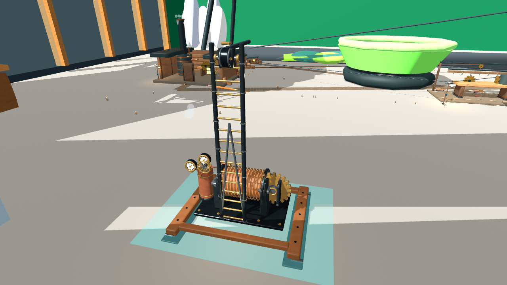
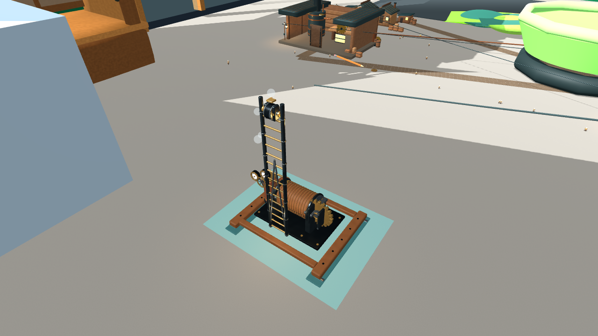

# Grapple challenger review — 2026-10-28

## Disposition

`grapple-v009` is a technically integrated challenger that fails the repaired visual gate. Keep `grapple-v006` as the best-so-far gameplay incumbent. The finite Grapple brief allows candidates through v009, so this is an attempt-limit block, not an evidence-backed technical plateau and not pilot acceptance. Do not begin broad asset migration.

## Candidate history

| Candidate | Result | Evidence |
|---|---|---|
| v007 | Blocked before geometry export. The Blender 5.2.3 script selected the removed `BLENDER_EEVEE_NEXT` setting. The failed record and log are preserved. | `art/grapple/iterations/v007/generation.log` |
| v008 | Generated and integrated. Godot validated the exact 8.7 × 11.67 × 7.5 inch envelope, three construction groups, 355 meshes and 280,760 triangles. Gameplay construction and traversal ran. It failed the strict visual gate: smooth pale coils, simple joins and uniform surfaces. | `art/grapple/iterations/v008/evaluation.json`; `art/grapple/iterations/v008/render-runs/run-001/` |
| v009 | Added beveled and turned components, collars, unions, fasteners, three-strand winding, packed PBR microtextures, and material batching. Godot validated the exact envelope, three stage groups, 17 meshes, 312,760 triangles, and no import issues. Production flow completed with construction, deployment, active floor-to-desk connection and citizen traversal. | `art/grapple/iterations/v009/evaluation.json`; `art/grapple/iterations/v009/render-runs/run-001/` |

## Strict visual gate — v009

| Check | Result | Production evidence |
|---|---|---|
| Would a neutral viewer call it a realistic manufactured grapple miniature? | **No** | The installed model remains visibly stylized; coil-like winding and simplified transitions dominate the read. |
| Does it hold up close without obvious primitive construction? | **No** | Detail view exposes simplified mast/base and bearing joins and regular, smooth winding. |
| Edge treatment | Pass | Skids, teeth, flanges, unions and mast parts have bevels or rounded profiles. |
| Joins | **Fail** | Mast foot, bearings, fittings and guards read as intersections rather than fitted assemblies. |
| Thickness | Pass | Skid, winch plate, gear, flanges and mast show coherent physical thickness. |
| Hardware | Pass | Fasteners, gauge indices, hubs, unions, collars, ferrules, axle and locknuts are legible. |
| Material response | **Fail** | Winding reads as copper-colored coils rather than hemp; timber and metal remain too clean and uniform. |
| Surface variation | **Fail** | Baked maps do not show convincing grain, forged finish, rope fibers or varied wear in the production render. |
| Manufacturing detail | **Fail** | Rope, gear mesh, bearing fits and plate transitions do not yet read as assembled and finished hardware. |
| Source-photo character | N/A | No source photograph is registered for the Grapple brief. |

The visual evaluation is `blocked` because the finite candidate limit is exhausted; `incumbent_comparison_result` is `same`. No promotion occurred. The evaluator names a different reference-driven fabrication method and warmed performance capture as the next hypothesis, but the current brief does not authorize another candidate. The v009 detail capture is a single sample (5,682 draw calls, 2,311,952 primitives, 45 FPS), not a warmed performance benchmark. v008's detail capture reported 6,997 draw calls; batching reduced this count, but does not establish a warmed performance improvement over v006.

## Preserved runtime state

`art/registry.json` still points to `grapple-v006` with its original hash and gameplay scene. The v007 blocked record and v008/v009 challengers, recipes, generation logs, evaluations and production captures remain append-only. `art_factory verify grapple` passes against the incumbent registry entry. No gameplay cable logic or RoomDefinition geometry changed in this repair cycle.
