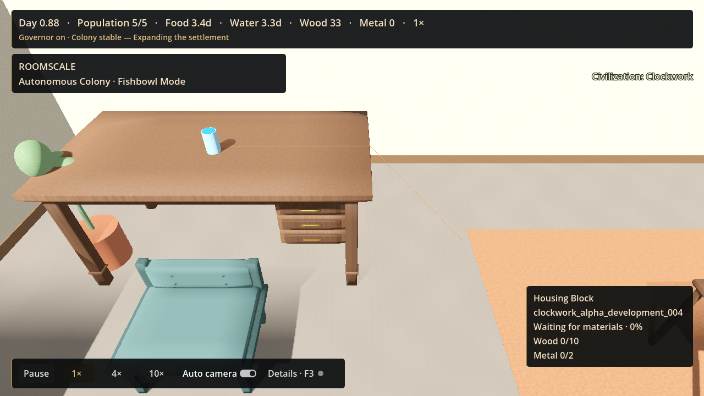
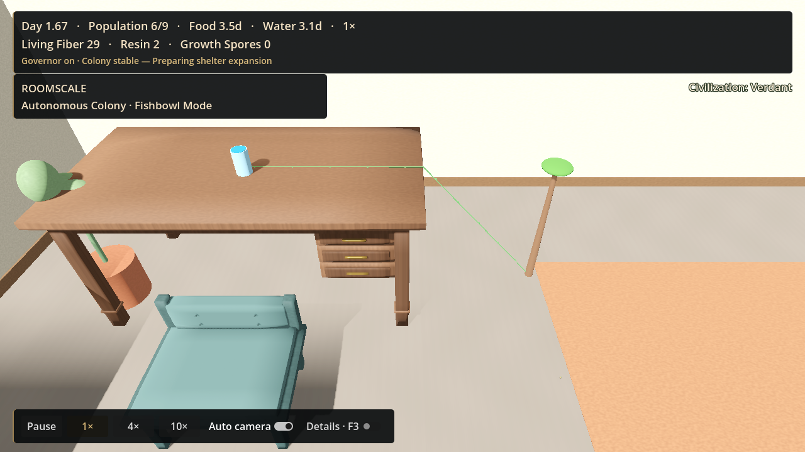
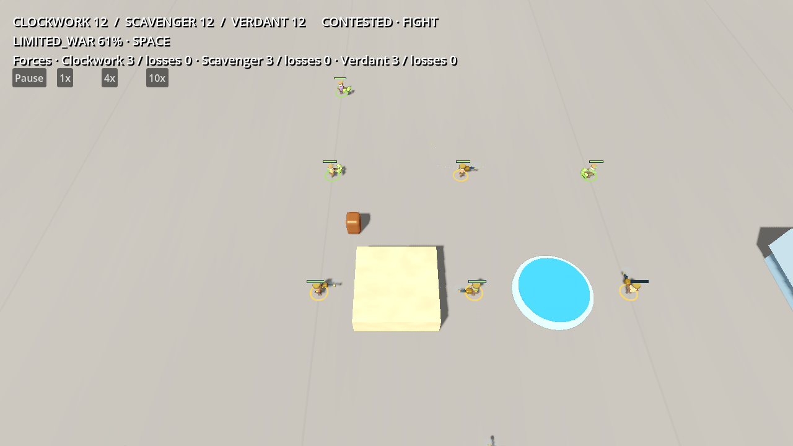

# POC 5.3 stabilization and extensibility review

Date: 2026-10-13. Branch: `codex/innovation-foundation-fixes`.
Baseline branch commit: `e0acddf`; baseline main: `71a2d1a`.

## Verdict

**PASS WITH CONCERNS.** Both merge blockers are fixed and all requested local gates
pass. The concerns are explicit prototype boundaries and finite-supply limitations,
not outstanding solution-order or mixed-war policy failures. Remote CI is reported
by the pull request after publication; this document records local verification.

[Compact receipts](acceptance-summary.json) and [normalized source manifest](change-manifest.json)
identify the verified working-tree changes. Only three inspected renderer images are
curated; raw runs remain ignored under `verification/stabilization/runs/poc53-stabilization/`.

## Fixed issues

1. **Global deployable selection.** Recognized pressures feed a global ranked list of
   viable supported solutions. Scores sum severity times normalized authored priority
   across distinct addressed problem types; each type contributes only its greatest
   severity. Exact ties use stable solution IDs. Source/type order cannot pick a project.
   Physically illegal/disconnected/claimed plans are excluded in score order and one
   project starts. Tests include critical water versus mild access, reversed inputs,
   ties, 100 mild duplicate sources, multi-problem benefits and unsupported classes.

2. **Mixed-intensity combat.** Model A derives each side's committed policy from the
   strongest bilateral hostility it personally participates in. Force size and morale
   retreat are per-side; the encounter maximum is only a summary label. Startup/step/
   policy/initiative ordering is canonical. The mixed fixture commits 4
   Clockwork and 12 Verdant citizens under survival policies,
   while Scavenger commits 2 of eight under a limited policy.
   It physically retreats with 1 survivor; the
   survival side is eliminated rather than receiving an ordinary morale retreat.
   Peaceful pairs never target each other. An unavailable required force rejects the
   entire engagement without touching tasks. A peaceful living claimant blocks exclusive
   capture even after fighting another opponent. Pair-specific contested benefits are
   validated scenario data, not injected war-intensity overrides.

3. **Adapter boundary.** The runtime orchestrates tasks, economy, labor, claims and
   completion. A data-registered adapter plans, checks target state, renders and applies
   its physical effect. Optional ongoing behavior receives fixed production ticks and
   pauses with the simulation. A test registers and physically builds a non-route class
   with food/water materials without editing the runtime or creating a phantom link.
   Climb geometry and living-structure behavior live in separate adapter implementations.

4. **Materials and recipes.** Projects iterate authored material fields. Canonical IDs
   are validated once through ResourceVocabulary, shared by catalogs/economy/resources.
   Unknown exotic materials fail rather than silently turning into free construction.
   Depot production is an explicit catalog opt-in recipe service, currently a single
   input/output metal-parts recipe with real reserved input and citizen work. Recipe jobs
   belong to their project and cancel with it. Output capacity is checked before input
   consumption; finite arithmetic overflow and non-finite inventory audits are covered.

5. **Experience/awareness.** Five-second fixed-clock evidence batches accumulate strength
   0.35 to recognition after three ordinary observations. Count, awareness, severity,
   first/last time and recognized time remain inspectable. Same-time duplicate calls are
   inert; contributions/context have stable order. Solved/disappeared opportunities clear
   evidence, and reappearance starts fresh. Manual targets provide strong evidence. The
   resolver ignores explicit emerging states, and recognition grants no technology or link.

6. **Mechanical diversity.** The earned-founder Verdant run researches its prerequisite
   chain and builds a permanent living structure. Its authored shelter property adds four
   real places to owner shelter/population-admission capacity only after full material
   delivery and citizen construction. The effect is idempotent and a second structure at
   the same region is rejected across all societies. Clockwork's grapple has no shelter
   effect. Renderer review also caught near-complete floating-point fractions omitting
   the final segment/canopy; completion now renders exactly the final visual state.

The combined room's former metal budget could not fund the new larger invention after
three ordinary settlements. It now authors a visible finite scrap tray yielding 24 metal
through two physical salvage stages. No acceptance driver grants depot construction stock.
The historical governor test's wood/metal wording assertion was changed to generic
material wording; its MATERIALS-policy requirement remains intact.

## Modularity assessment

**Can a fourth highly distinct civilization be added without modifying the innovation
resolver? Yes.** Definition/catalog data, generic capability/problem data when needed,
registered physical adapters and opt-in recipes are the extension points. Scavenger still
has independent knowledge and its authored prerequisite chain. New canonical materials
need a resource/economy supply contract; cosmetic aliases alone are not such a contract.

**Can a new physical class be added without modifying the innovation runtime? Yes, within
the documented adapter protocol.** Register its implementation and validate its own
properties; planning must be pure, rendering cosmetic and completion atomic/idempotent.
Its optional persistent hook uses the shared clock. A new domain effect may also require
an appropriate domain authority; the registry does not automatically implement reservoirs,
lifts, generators or arbitrary game systems. Adapters are trusted repository code.

Architecture searches found no civilization-ID/technology-ID/solution-ID branches in
the core resolver, awareness, detector or generic deployment dispatcher. Innovation
orchestration no longer enumerates wood/metal/parts. Presentation/tests/data still name
civilizations and inventions intentionally. Normal settlement blueprints and food/water
self-care remain specialized, separate prototype systems.

## Mechanical diversity assessment

| Earned solution | Bill | Construction labor | Actual extra benefit |
|---|---|---:|---|
| Clockwork grapple | Wood 1, metal 2, parts 1 | 60 seconds | Shared climb access; no shelter |
| Verdant living tree | Wood 10, metal 2, parts 2 | 230 seconds | Shared climb access and +4 owner shelter places |

The six-founder tree scenario goes from five to nine shelter places. Its proof uses
normal travel, research, hauling, fabrication and labor. The earlier vine can already
provide access; the later structure supplies a separate tested gameplay benefit.
Catalog throughput and operating-cost labels are not implemented mechanics.

## Determinism and regression results

| Gate | Evidence |
|---|---|
| New solution/evidence/adapter/material contracts | 38 assertions; 3 identical fresh runs |
| Mixed physical war | 3815 assertions; 3 identical runs, each also reverses participant/runtime input |
| Existing innovation foundation | Original contracts plus 97 robustness assertions |
| Live catalogs | Clockwork, Verdant, Scavenger: 3 identical runs each |
| Mechanically distinct tree | 3 identical earned-founder runs |
| Cancellation/material recovery | 3 identical recovery/retry runs |
| Two-party combat | 5 identical runs; complete pre-stabilization gameplay fingerprint reproduced |
| Second conflict room | Pass |
| Uniform three-party combat | 3 identical runs |
| Combined invention/conflict | 3 matching combat fingerprints; paid shared access and real collection |
| Fast | Ruff/Python/tooling/startup/focused gates pass |
| Canonical | 3 identical founder repeats |
| Historical Regression | All gates pass; 20/20 exploration cases, no invariant failures/deadlocks |
| Original production smokes | Clockwork/Verdant × Room A/B: 4/4 pass |
| Civilization contracts | Pass |
| Renderer | Clockwork climb, living tree, three-party battle inspected |

Two-party Clockwork capture remains tick 1620. The canonical three-party capture is
now Verdant at tick 1868; canonical instance ordering,
not a civilization bonus, determines initiative and physical station assignment.
No raw simulation/result directories are included in the commit. CI configuration
adds the focused mixed/awareness/material and living-tree repeatability gates.

## Remaining limitations

- Implemented detectors are vertical access and insufficient shelter. Awareness is a
  deterministic repeated-observation foundation, not sight/range/learning/personality.
- Construction ranks currently viable projects when idle; it does not automatically
  preempt funded work because another urgency changes. Global cross-society affordability
  allocation is absent; exhausted finite material can legitimately stall a project.
- Only climb routes and one living-structure effect are production adapters. No powered
  lifts, reservoirs, defensive structures, route concurrency, fuel or maintenance model.
- The canonical material vocabulary has five IDs; recipes are single input/output and
  workshop eligibility. Recipe chains and arbitrary exotic economies are not proven.
- Shelter effect is capacity/admission, not a new physical sleeping-interior simulation.
  Art is a primitive trunk/canopy/route; structural physics and realistic growth are absent.
- Combat is one contested floor-site engagement. Commitment snapshots do not perform
  mid-battle recruitment. No treaties/coalition ownership or elevated fighting. Full-force
  survival commitment waits if a complete eligible roster cannot be fielded.
- Long soaks, arbitrary large-party worlds and save/load were not tested in this pass.

## Recommended next milestone

Add deterministic water-pressure observations and one finite reservoir adapter through
these boundaries. Require real collection/storage/withdrawal accounting and an observed
benefit under a resource shortage. This exercises the water-versus-access ranking with
production content while keeping powered lifts, broad technology trees and diplomacy
outside the milestone.

## Inspected visual evidence

Clockwork climb (no shelter bonus):

Verdant living structure (HUD shows six citizens and nine shelter places):

Three-party battle (all societies and committed forces visible):

